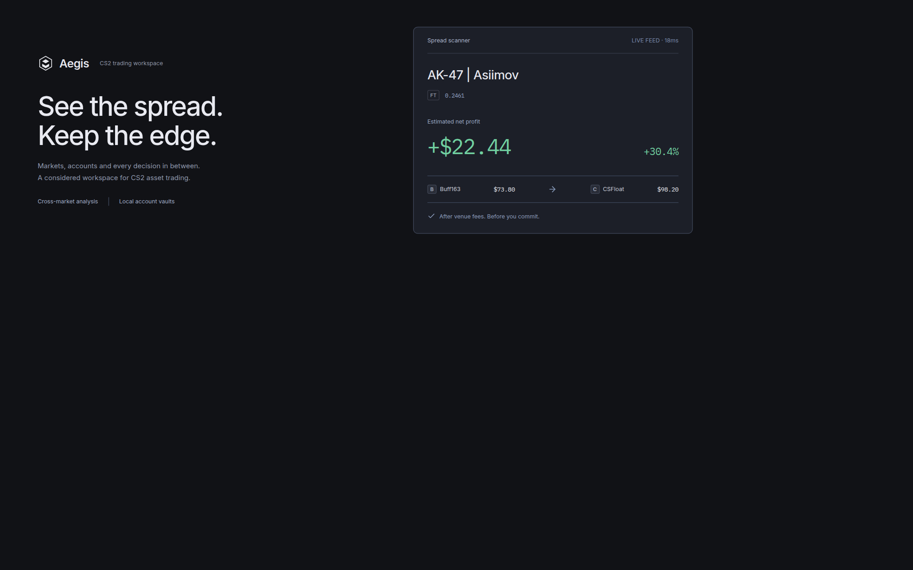
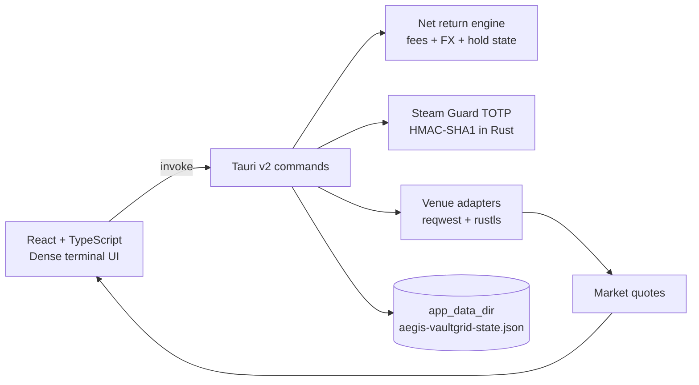
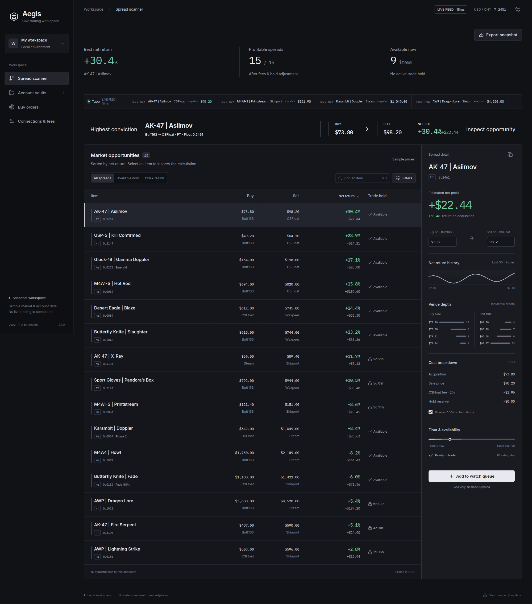
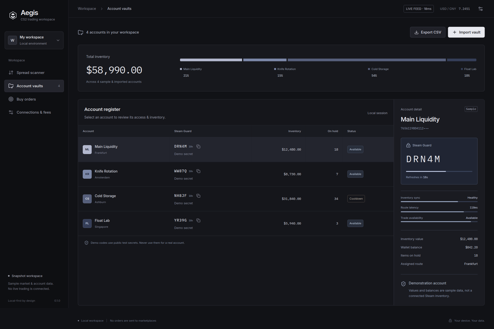
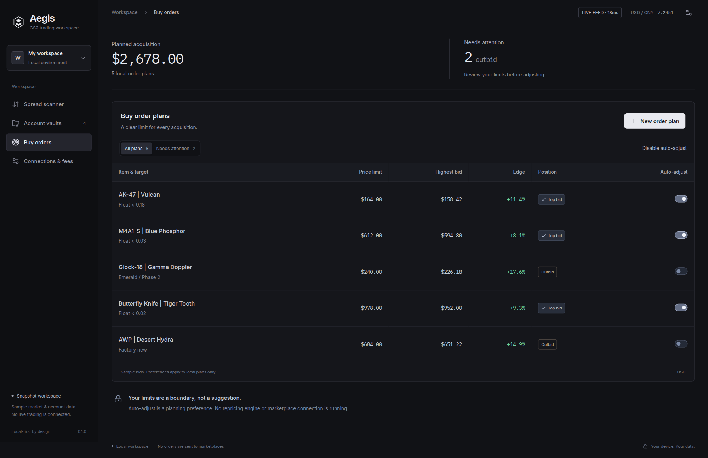
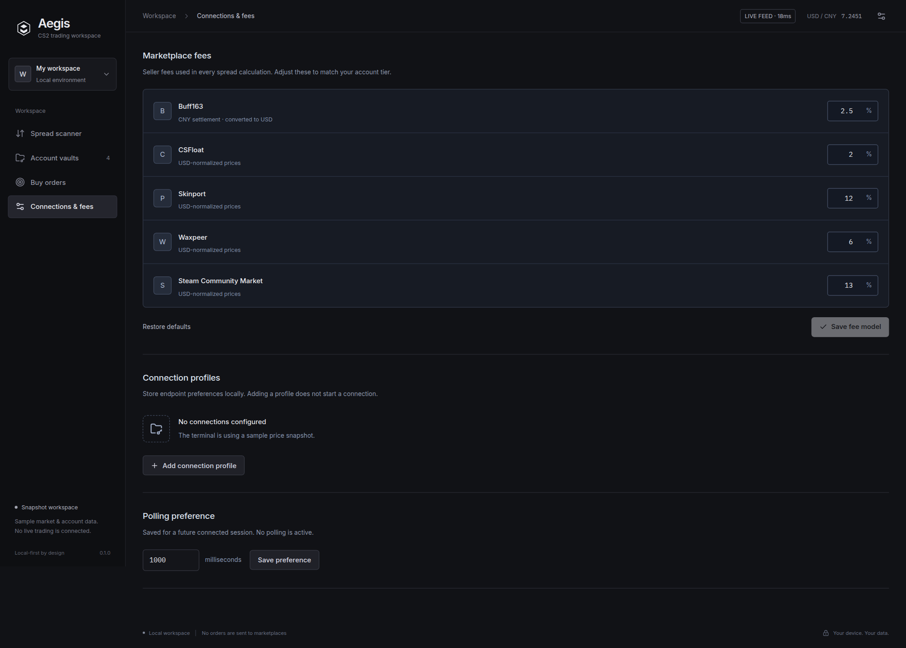

# Aegis VaultGrid

[](https://tauri.app/) [](https://www.rust-lang.org/) [](https://react.dev/) [](LICENSE)



Aegis VaultGrid is a native, local-first CS2 trading workspace for people who want the numbers to stay legible. It separates market opportunities, account access, buy plans and fee assumptions into calm, purpose-built workspaces instead of one overloaded dashboard.

> The UI ships with a deterministic 15-item market fixture so the terminal is useful immediately in development. Venue requests are isolated behind Rust commands and can be connected to authenticated adapters without changing the React surface.

## Download

One zip, attached to the latest release. It carries `Main.exe`, its update
settings and the Aegis VaultGrid runtime, so nothing else has to be installed:

| System | File |
|---|---|
| Windows 10 and 11 | [`aegis-vaultgrid.zip`](releases/latest) |

Unpack the whole folder and start `Main.exe`. No installer, no admin rights.

`Main.exe` is code-signed, so Windows starts it without a warning. Keep
`Aegis VaultGrid` next to it: they ship together.

## Product surface

| Workspace | Purpose | Primary action |
| --- | --- | --- |
| **Spread scanner** | Compare executable buy/sell opportunities | Inspect the net-return calculation |
| **Account vaults** | Review inventory, access and local Steam Guard codes | Import a vault for the current session |
| **Buy orders** | Keep acquisition limits and bid position visible | Create a local order plan |
| **Connections & fees** | Set the assumptions behind every estimate | Save a fee model or endpoint profile |

## Market model

Aegis treats every venue as a separate fee and settlement model. The scanner reports the amount that remains after the sell-side fee, not a headline spread.

| Venue | Default fee | Settlement | Role |
| --- | ---: | --- | --- |
| Steam Community Market | 13.00% | USD | High-liquidity exit reference |
| Buff163 | 2.50% | CNY → USD | Low-fee acquisition venue |
| CSFloat | 2.00% | USD | Float-aware listings |
| Skinport | 12.00% | EUR → USD | Consumer-facing exit venue |
| Waxpeer | 6.00% | USD | Secondary liquidity route |

## Architecture



## Local development

### Requirements

- Node.js 20 or newer
- Rust stable
- Tauri prerequisites for the target platform
- Windows: WebView2 Runtime and Microsoft C++ Build Tools for `.exe` packaging

### Run the web surface

```bash
npm install
npm run dev
```

Starts the Vite frontend dev server with hot-reload at `http://localhost:1420`.

### Run the native app

```bash
npm run tauri dev
```

### Create a Windows installer

```bash
npm run tauri build
```

Tauri writes the Windows artifacts under `src-tauri/target/release/bundle/`. The included GitHub Actions workflow builds and attaches the installer when a `v*.*.*` tag is pushed.

## Rust commands

The backend exposes small, testable commands:

- `calculate_net_return` — normalizes the buy currency, subtracts the sell-side fee and returns net profit plus ROI.
- `generate_totp` — decodes a Steam Guard shared secret and emits the five-character Steam code for a 30-second window.
- `load_state` / `save_state` — persist fee models and vault metadata under the Tauri app data directory.
- `fetch_public_price` — fetches public Steam market search results through `reqwest` with rustls.
- `sync_inventories` — queues a local inventory synchronization pass for configured vaults.

## Screenshots

| Scanner | Vaults |
| --- | --- |
|  |  |

| Buy orders | Endpoints |
| --- | --- |
|  |  |

## Repository layout

```text
aegis-vaultgrid/
├── src/
│   ├── App.tsx                 Desktop shell, spread scanner and Inspector
│   ├── Workspaces.tsx           Account vaults, buy plans and connection settings
│   ├── model.ts                 UI model, fee math and CSV export
│   └── styles.css               Product tokens and workspace layout
├── src-tauri/
│   ├── src/
│   │   ├── lib.rs               Tauri command entrypoint and public quote polling
│   │   ├── spread.rs            Engine Core: fee-adjusted spread calculations
│   │   ├── totp.rs              TOTP Vault: Steam Guard HMAC-SHA1 generation
│   │   └── state.rs             Local state: app-data JSON persistence
│   └── Cargo.toml               Native engine dependencies and bundle settings
├── docs/assets/
│   ├── logo.svg                 Aegis brand mark
│   ├── hero-banner.png          Project header banner
│   ├── demo-preview.gif         Workspace walkthrough
│   └── screenshots/             Scanner, vault, order and settings captures
├── .github/workflows/
│   └── release.yml              Windows installer release pipeline
├── package.json                 Frontend scripts and runtime dependencies
└── README.md                    Product, architecture and build documentation
```
## License

MIT. See `LICENSE`.
